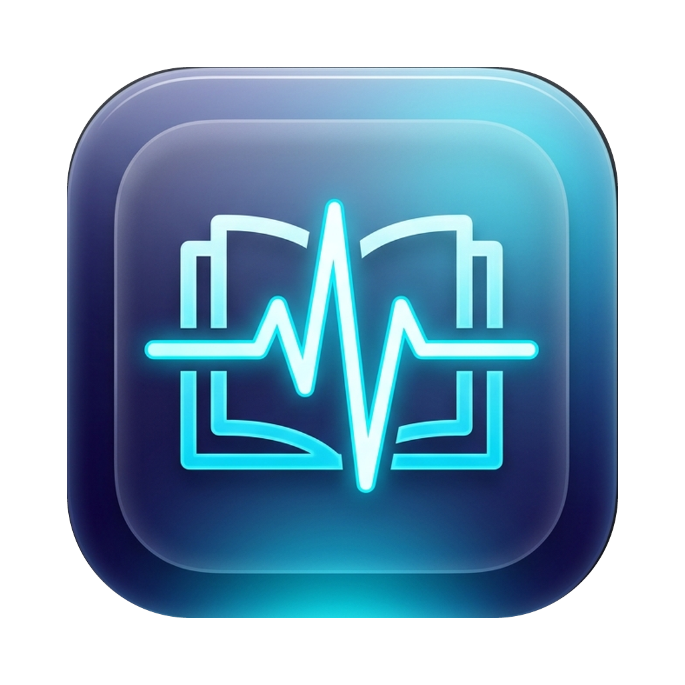

<div align="center">
  
  <h1>Brightspace Pulse for macOS</h1>
  <p><strong>A native, high-performance macOS academic hub and menu bar utility for Brightspace (D2L).</strong></p>

  <p>
    <a href="https://github.com/saitft/Brightspace-Pulse/releases/latest"></a>
    
    
    <a href="LICENSE"></a>
    
  </p>

  <p>
    Brings your assignments, quizzes, in-person exam countdowns, categorized grades, CGPA/GPA calculations, and hundreds of lecture slides directly to your Mac desktop with standard Apple Liquid Glass design.
  </p>
</div>

---

## ⚡ Quick Download & Install (No Terminal Needed)

### Step 1: Download
👉 **[Download Brightspace-Pulse-v1.0.0-macOS.zip](https://github.com/saitft/Brightspace-Pulse/releases/download/v1.0.0/Brightspace-Pulse-v1.0.0-macOS.zip)** *(2.3 MB)*  
Or visit the [Releases Page](https://github.com/saitft/Brightspace-Pulse/releases/latest) for release notes.

### Step 2: Install
1. Double-click the downloaded `.zip` file to extract **`Brightspace Pulse.app`**.
2. Drag **`Brightspace Pulse.app`** into your **`Applications`** folder.

### Step 3: First Launch (macOS Gatekeeper)
> [!IMPORTANT]  
> Because Brightspace Pulse is a free, open-source student project built without a paid \$99/yr Apple Developer certificate, macOS will show a prompt saying **"Apple cannot check it for malicious software"** on the first launch.

**To open it in 5 seconds (only needed once):**
* **Method A (Easiest — In Finder):**
  1. Open your `/Applications` folder.
  2. **Right-click (or Control-click)** on `Brightspace Pulse.app` and choose **Open**.
  3. Click **Open** in the confirmation dialog. That's it!
* **Method B (Terminal One-Liner):**
  ```bash
  xattr -cr "/Applications/Brightspace Pulse.app"
  ```

---

## 🎓 Connecting Your University (Any D2L / Brightspace Portal)

Brightspace Pulse works out of the box with **any university or college** powered by D2L Brightspace.

```
┌────────────────────────────────────────────────────────┐
│  Brightspace Single Sign-On                            │
│  [ Preset Buttons: uOttawa | Carleton | Waterloo ... ] │
│  Portal URL: [ https://uottawa.brightspace.com      ]  │
│  ┌──────────────────────────────────────────────────┐  │
│  │  University Microsoft / Duo 2FA / SSO Login Page │  │
│  └──────────────────────────────────────────────────┘  │
└────────────────────────────────────────────────────────┘
```

1. **Open Brightspace Pulse:** Launch the app from `/Applications` or your menu bar.
2. **Open the Login Sheet:** Click **Sign In with Brightspace** (or click the Settings gear).
3. **Select Your School or Enter URL:**
   - Click one of the built-in quick presets:
     - **uOttawa** (`https://uottawa.brightspace.com`)
     - **Carleton** (`https://brightspace.carleton.ca`)
     - **Waterloo** (`https://learn.uwaterloo.ca`)
     - **TMU (Toronto Metropolitan)** (`https://my.torontomu.ca`)
     - **Calgary** (`https://d2l.ucalgary.ca`)
   - *Using another school?* Type your institution's Brightspace portal address into the bar and click **Load**.
4. **Log in normally:** Sign in with your university credentials (SSO, Duo 2FA, Microsoft 365, Okta).
5. **Zero-Config Sync:** The moment you finish logging in:
   - Secure session tokens (`d2lSessionVal`, `d2lSecureSessionVal`) and CSRF tokens are captured directly into your encrypted **macOS Keychain**.
   - The login window automatically closes.
   - The app instantly calls the D2L Valence REST APIs to auto-discover all your active courses, assignments, quizzes, syllabi, lecture files, and grade items.

---

## 🖥️ What You Get

| Section | What It Does |
| :--- | :--- |
| **📅 Upcoming & Exams** | Live countdown timers for pending assignments, quizzes, and in-person midterms/finals extracted from course outlines, with **48-hour crunch alerts** and direct submission links. |
| **📂 Course Files Browser** | Instant search and indexing across 290+ downloaded PDFs, slides, code files, and lab manuals with one-click Open or Reveal in Finder. |
| **📊 Grades & Standing** | Complete breakdown of released grades, weighted averages, letter grade distributions (`A+` to `F`), and real-time **uOttawa 10.0 CGPA & North American 4.0 GPA** calculations. |
| **⚡ Menu Bar Utility** | Subtle status item in your macOS top menu bar showing sync status, quick access to upcoming deadlines, and instant sync triggers. |

---

## 🔒 Security & Privacy First

- **Zero Cloud Intermediaries:** Brightspace Pulse connects directly from your Mac to your university's official Brightspace/D2L servers. There are no proxy servers, third-party backends, or analytics.
- **Passwords Never Seen:** The app uses an embedded Apple WebKit sheet for Single Sign-On. Your password goes strictly to your university's authentication provider (Microsoft/Okta/Duo).
- **Encrypted Local Storage:** All session tokens are saved in the secure macOS Keychain (`kSecClassGenericPassword`) and local sandboxed caches.

---

## 🛠️ Building From Source (Developers)

If you prefer building from source or contributing:

### Prerequisites
- macOS 14.0 (Sonoma), macOS 15.0 (Sequoia), or macOS 26.0+ (Tahoe)
- Xcode Command Line Tools: `xcode-select --install`

### Build & Package
```bash
# 1. Clone this repository
git clone https://github.com/saitft/Brightspace-Pulse.git
cd Brightspace-Pulse

# 2. Run the unit & integration test suite (108 assertions across 8 test suites)
./run_tests.sh

# 3. Build optimized Universal release binary & package .app bundle
./bundle_app.sh

# 4. Run the app
open "Brightspace Pulse.app"
```

---

## ❓ Frequently Asked Questions (FAQ)

<details>
<summary><strong>Does this work for universities outside of Canada?</strong></summary>
Yes! Brightspace Pulse is compatible with any educational institution worldwide that uses D2L Brightspace. Simply enter your institution's URL in the login address bar.
</details>

<details>
<summary><strong>Where are downloaded files stored?</strong></summary>
Files are saved locally to structured course folders on your Mac (default: <code>~/Documents/BrightspaceSync</code> or any folder of your choice). You can change this anytime in Settings.
</details>

<details>
<summary><strong>How does Google Drive / NotebookLM integration work?</strong></summary>
Brightspace Pulse can automatically mirror all downloaded lecture slides, lab manuals, and PDFs into a synchronized folder on your Google Drive (<code>00_Course_NotebookLM_Index.md</code>), allowing you to query your entire course materials instantly using Gemini or Google NotebookLM.
</details>

<details>
<summary><strong>Why do I need to Right-Click Open on first launch?</strong></summary>
Apple requires software developers to pay \$99 USD every year for an Apple Developer ID certificate to bypass the Gatekeeper prompt. Because this is a free, non-profit student tool, it uses ad-hoc codesigning. Right-clicking and selecting "Open" once grants your Mac permanent permission to run it safely.
</details>

---

## 📜 License

Released under the [MIT License](LICENSE).  
Created and maintained by [**saitft**](https://github.com/saitft).
